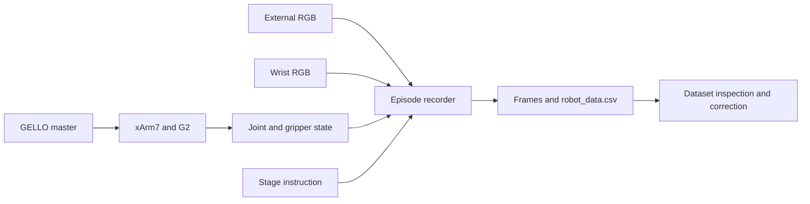
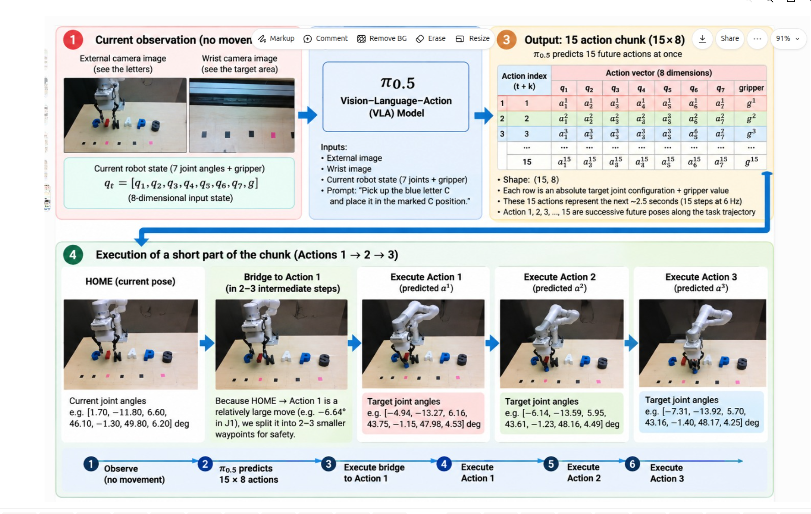
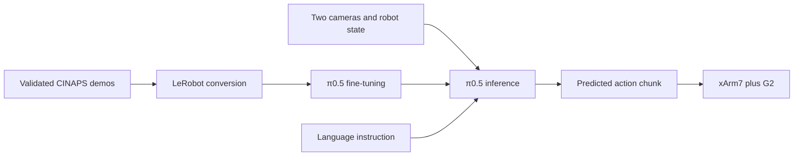
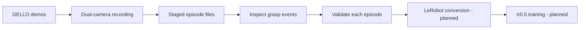
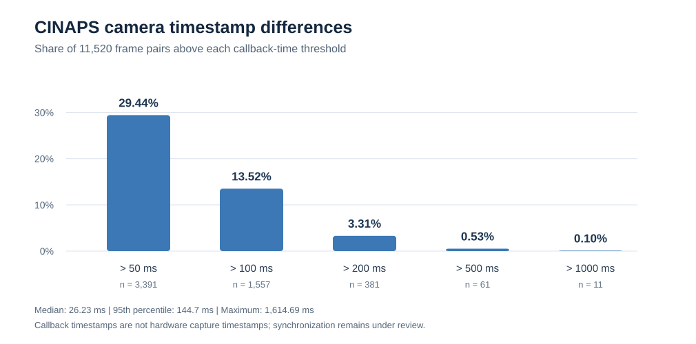
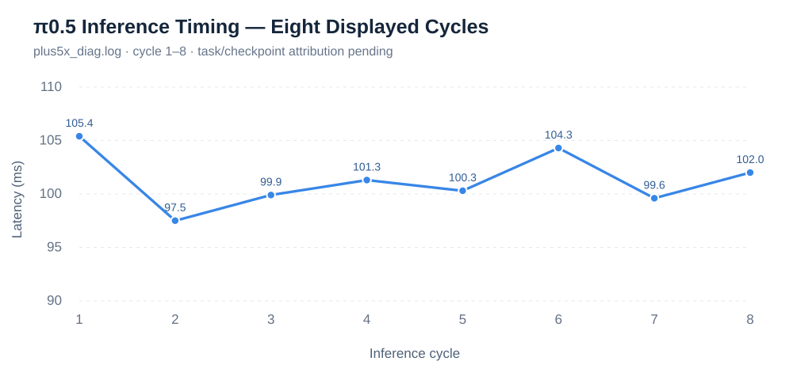

# π0.5 xArm7 CINAPS Letter Stacking

<p align="center"><b>GELLO teleoperation and staged CINAPS letter manipulation with UFactory xArm7 — towards π0.5 Vision-Language-Action learning</b></p>

<p align="center">
  
  
  
  
  
</p>

> **Project status:** GELLO teleoperation and data-collection tooling are documented. A corrected dataset directory with 50 episode folders (4.3 GB) has been located, and a 50-episode grasp-event report exists. These facts do **not** establish 50 successful placements, complete six-letter stacking, or trained π0.5 inference on CINAPS. Full episode-level validation and policy training remain future work.

---

## Overview

This repository documents a real-robot **CINAPS** letter-manipulation workflow using a **UFactory xArm7**, **UF G2 gripper**, **Dynamixel-based GELLO** teleoperator, and **external plus wrist RealSense cameras**. The staged task is to pick and place the letters **C, I, N, A, P, S** in their corresponding target positions.

The current work focuses on GELLO/xArm7 integration, joint-current tuning, image-and-robot-state demonstration recording, and dataset inspection. Local **π0.5 / OpenPI** training checkpoint directories and action-chunk experiment scripts are now confirmed. Physical execution outcomes and success rates still require verification.

### Key Features

| Component | Details |
|---|---|
| Robot | UFactory xArm7, 7-DOF |
| Gripper | UFactory UF G2 |
| Teleoperation | GELLO / Dynamixel |
| Cameras | External and wrist Intel RealSense RGB |
| System | Ubuntu 24.04; ROS 2 Jazzy |
| Recorder sampling rate | 6 Hz in inspected staged recorder |
| Collection organization | 50 staged demonstrations |
| Located corrected dataset | `xarm_demos_cinaps_staged_50_corrected`, 4.3 GB locally |
| Planned training format | LeRobot |
| Planned VLA policy | π0.5 / OpenPI |

---

## System Architecture

### Recorded demonstration workflow



### Planned VLA Workflow

<p align="center">
  
</p>

*Illustration of the planned π0.5 action-chunk workflow.*




---

## Real-Robot Setup

The hardware comprises xArm7, G2 gripper, a Dynamixel GELLO master, and two camera views. For the exact network/serial startup sequence, clutch behavior, safety checks, and previously observed controller errors, see [GELLO setup](docs/gello_setup.md).

Robot control scripts can command physical motion. Do not run multiple programs that own the robot or GELLO serial interface at the same time. Before testing, confirm emergency-stop access, clearance, joint mapping, robot readiness and gripper behavior.

---

## CINAPS Task Definition

The full objective is to arrange the scattered letters to spell **CINAPS** in order on the marked targets. The observed staged recorder uses this plan:

| Episode numbers | Stage | Demonstration instruction |
|---|---|---|
| 1–8 | C | Place C while all letters start scattered |
| 9–16 | I | Keep C fixed; place I |
| 17–24 | N | Keep C and I fixed; place N |
| 25–32 | A | Keep CIN fixed; place A |
| 33–40 | P | Keep CINA fixed; place P |
| 41–48 | S | Keep CINAP fixed; place S |
| 49–50 | FULL | Arrange C → I → N → A → P → S |

The sequence above describes the *collection design*, not a certified task-success count. The single-letter starting task is: **“Pick up the blue letter C and place it in the marked C position.”**

---

## Dataset and Workflow

The inspected local source script is `~/cinaps_collection/record_cinaps_staged_50.py`. It sets `FPS = 6.0`, reads external and wrist image topics, and records GELLO/xArm7 state into episode data. Its launcher is `run_record_cinaps_staged_50.sh`. The staged recorder and launcher are now available in [`data_collection/`](data_collection/). **Caution:** the recorder includes hardware-specific HOME angles and connection settings and can initiate physical robot movement; review and adapt it for your own setup. Public release permission for lab materials remains the repository owner's responsibility.

The local corrected dataset has **50 episode directories** and occupies **4.3 GB**. A separate report, *CINAPS 1–50 Grasp Report*, presents detected gripper-closing frames, camera images, joint data and G2 measurements. Gripper closure alone does not prove that an object was securely grasped or placed.



Further details: [Collection guide](docs/cinaps_collection.md) · [Grasp-report summary](docs/cinaps_grasp_report.md).

### Recording source files

| Stage | Local source file | Repository status |
|---|---|---|
| Staged recording | [`record_cinaps_staged_50.py`](data_collection/record_cinaps_staged_50.py) | Published; hardware review required |
| Staged launcher | [`run_record_cinaps_staged_50.sh`](data_collection/run_record_cinaps_staged_50.sh) | Published |
| General collection | `collect_cinaps_50.py` | Pending review/upload |
| General collection launcher | `run_cinaps_50.sh` | Pending review/upload |

---

## Repository Structure

```text
pi0.5-xArm7-cinaps-stacking/
├── assets/
│   └── cinaps_planned_vla_workflow.svg
├── gello_teleoperation/
│   ├── config/
│   │   └── xarm7_gello_local.yaml
│   ├── safe_gello_with_gripper.py
│   ├── test_gello_stiffness.py
│   └── README.md
├── docs/
│   ├── gello_setup.md
│   ├── gello_stiffness.md
│   ├── cinaps_collection.md
│   ├── cinaps_grasp_report.md
│   └── progress_checklist.md
├── data_collection/
│   ├── record_cinaps_staged_50.py
│   └── run_record_cinaps_staged_50.sh
├── data_processing/
│   └── validate_cinaps_dataset.py
├── evaluation/
│   └── cinaps_dataset_validation.md
├── .gitignore
└── README.md
```

**Planned additions:** approved task media in `assets/`, preprocessing and LeRobot conversion tools, `inference/`, and `tests/` as actual implementations are reviewed.

---

## Installation and Environment

```bash
git clone https://github.com/KLochan/pi0.5-xArm7-cinaps-stacking.git
cd pi0.5-xArm7-cinaps-stacking

# Existing local environment used during development:
source ~/ufactory_teleop/.venv-gello/bin/activate
source /opt/ros/jazzy/setup.bash
source ~/xarm_ws/install/setup.bash
```

The GELLO driver and `ufactory_devices` modules originate from the developer's local upstream environment and are **not bundled** here. The committed YAML contains placeholders for machine-specific connection details. Refer to [GELLO setup](docs/gello_setup.md) for prerequisites; do not assume that cloning alone creates a runnable robot-control installation.

## Running the Project

The historically used startup command from the *original GELLO workspace* is:

```bash
cd ~/ufactory_teleop/gello_teleop
source ../.venv-gello/bin/activate
python safe_gello_with_gripper.py --config config/xarm7_gello_local.yaml
```

**Physical-motion warning:** Do not execute the command without supervised readiness/synchronization checks. A recorded controller error during one startup was resolved in a later session; no automatic error clearing is performed. The 20-degree tracking-lag parameter in the historical script is **diagnostic only**, not an enforced stop. Use hardware emergency stop if required; the software clutch is not an emergency stop.

The staged recording launcher also controls/coordinates data-collection activity and is **not a one-command safe startup recipe** until its remaining code and hardware effects are inspected.

---

## CINAPS Dataset Validation and Camera Synchronization

The corrected dataset was examined on October 15, 2026. The **initial structural check found 0 failures**; a stricter per-episode audit returned **0 `FAIL` and 50 `WARN`** because at least one camera callback timestamp pair in every episode exceeded the 100 ms warning threshold.

### Dataset overview

| Measure | Observed result |
|---|---:|
| Corrected dataset | `xarm_demos_cinaps_staged_50_corrected` (local workstation) |
| Episode directories | **50** |
| Total robot CSV records | **11,520** |
| External camera JPEG frames | **11,520** |
| Wrist camera JPEG frames | **11,520** |
| Initial structural failures | **0** |
| Stricter validator structural failures (`FAIL`) | **0** |
| Episodes with camera timing warnings (`WARN`) | **50** |
| Camera resolution (both views, sample frame) | **1280 × 720** |
| Corrected dataset disk usage | **4.3 GB** |
| System Python OpenCV version | **4.6.0** |

### Camera callback timestamp analysis

| Metric | Absolute external/wrist difference |
|---|---:|
| **Median** | **26.23 ms** |
| **95th percentile** | **144.70 ms** |
| **Maximum** | **1,614.69 ms** (episode 0012) |
| Other large observed maximum | 1,557.8 ms (episode 0046) |

| Threshold exceeded | Frame pairs | Percentage of 11,520 |
|---|---:|---:|
| > 50 ms | 3,391 | 29.44% |
| > 100 ms | 1,557 | 13.52% |
| > 200 ms | 381 | 3.31% |
| > 500 ms | 61 | 0.53% |
| > 1,000 ms | 11 | 0.10% |

**Interpretation:** **86.48%** of pairs had callback timestamp differences **≤100 ms**, but this does not verify synchronized camera capture. The recorder stores **callback-reception timestamps**, which can differ from the sensors' exposure times. The maximum is an outlier, but timing outliers require review before LeRobot conversion. These checks are **not** measurements of grasp or placement success.

Full results and methodology: [CINAPS dataset validation report](evaluation/cinaps_dataset_validation.md).

Run the read-only validator:

```bash
/usr/bin/python3 data_processing/validate_cinaps_dataset.py \\
  --dataset ~/xarm_demos_cinaps_staged_50_corrected \\
  --report /tmp/cinaps_validation.csv
```

---

## Evaluation and Grasp Report

A local **50-episode grasp-event analysis** exists for `xarm_demos_cinaps_staged_50_corrected`; it includes external and wrist views, seven joint values, gripper measurements and frames around the first detected gripper closing in each episode.

| Metric | Current evidence |
|---|---|
| Corrected episode folders | 50 |
| Corrected dataset size | 4.3 GB |
| Recording target rate | 6 Hz |
| Grasp-event analysis | Report produced |
| Verified successful placements | Not yet quantified |
| Verified full-sequence successes | Not yet quantified |
| CINAPS π0.5 inference latency | Not measured |


### Camera timestamp differences across 50 episodes

<p align="center">
  
</p>

Across **11,520** external/wrist frame pairs, the median absolute camera callback timestamp difference was **26.23 ms** (95th percentile **144.7 ms**). **13.52%** of pairs exceeded 100 ms. All 50 episodes passed structural checks, but each included at least one timestamp warning. These are **callback reception times, not hardware capture timestamps**, so sensor synchronization and potential frame staleness still require investigation. See [full dataset validation](evaluation/cinaps_dataset_validation.md).

See [Grasp-report notes](docs/cinaps_grasp_report.md) and [Progress checklist](docs/progress_checklist.md). No handwash-task inference latency or success statistics are attributed to CINAPS.

---

## π0.5 Inference Timing — Preliminary Measurements

The following **eight inference times** were extracted from cycles 1–8 of `~/openpi/plus5x_diag.log`. The log shows repeated policy inference, but its exact task and checkpoint have **not yet been verified**, so these values are **preliminary log measurements, not a certified CINAPS benchmark**.

<p align="center">
  
</p>

| Cycle | Inference time |
|---|---:|
| 1 | 105.4 ms |
| 2 | 97.5 ms |
| 3 | 99.9 ms |
| 4 | 101.3 ms |
| 5 | 100.3 ms |
| 6 | 104.3 ms |
| 7 | 99.6 ms |
| 8 | 102.0 ms |

These are **per-inference measurements** reported by the log, not full perception-to-actuation cycle times or robot task-success results. The `plus5x_diag.log` sample also shows accepted velocity and gripper commands, but successful object manipulation remains to be demonstrated from independent evidence.

---

## Published CINAPS π0.5 Inference Scripts

The following **experimental implementations are now available** in this repository:

| Script | Purpose |
|---|---|
| [One-shot inference](inference/xarm_pi05_cinaps_one_shot.py) | Predict an 8-D action, limit the arm movement, and require operator confirmation before a single motion command |
| [Five-action chunk](inference/xarm_pi05_cinaps_chunk5.py) | Predict A1–A5, validate demonstration-derived joint step/range constraints, then request manual approval for each target |
| [Inference guide](inference/README.md) | Inputs, checkpoint notes, and safety limitations |

These scripts have **robot-motion capability** and are research prototypes, not verified collision-safe controllers. In both experiments the gripper is observed but not commanded. Publishing the code does not establish task-success results.

---

### LeRobot Conversion Implementation

The corrected CINAPS demonstration dataset is converted using [`xarm_to_lerobot_cinaps_50_corrected.py`](data_processing/xarm_to_lerobot_cinaps_50_corrected.py), which processes the 50 staged episodes with external/wrist RGB frames, seven joint observations, one normalized gripper value and eight-component actions at 6 Hz.

**Existing-data protection:** The published converter refuses to overwrite an existing LeRobot output directory. It does **not** remove the previously converted dataset automatically. Camera callback timestamp outliers documented in [dataset validation](evaluation/cinaps_dataset_validation.md) should be reviewed before future training runs.

## π0.5 Training and Action-Chunk Implementation

### Verified π0.5 Training Configuration

The following settings were inspected in the actual corrected-CINAPS OpenPI training configuration:

| Parameter | Actual value |
|---|---|
| Training configuration | `pi05_xarm_cinaps_staged_50_corrected_lora` |
| Dataset | `lochan/xarm_cinaps_staged_50_corrected` |
| Model | π0.5 |
| Training method | LoRA |
| Action dimension | 32 (model configuration) |
| Action horizon | 15 |
| Batch size | 1 |
| Training steps | 30,000 configured |
| Peak learning rate | 2.5 × 10⁻⁵ |
| Final learning rate | 2.5 × 10⁻⁶ |
| Warmup | 1,000 steps |
| Optimizer | AdamW |
| Gradient clipping norm | 1.0 |
| Base checkpoint | `gs://openpi-assets/checkpoints/pi05_base/params` |
| Weights & Biases | Disabled |

Saved CINAPS checkpoint directories were observed through **step 29,999**. The model's configured 32-dimensional action representation differs from the **8 action components** consumed by the local xArm7 inference code (7 joints + gripper).

More details: [Training configuration and checkpoint metadata](training/README.md).


The workstation inspection confirmed local **π0.5 CINAPS LoRA training outputs** and experimental inference scripts. This project is therefore beyond data collection, although the available command outputs do not yet establish a quantitative autonomous task-success rate.

| Component | Verified local evidence |
|---|---|
| Corrected CINAPS LoRA training | Checkpoint directories under `pi05_xarm_cinaps_staged_50_corrected_lora` |
| Saved steps (two run directories) | **5,000; 10,000; 15,000; 20,000; 25,000; 29,999** |
| Corrected checkpoint directory storage | **107 GB** (all contents combined) |
| LeRobot dataset | Cached `lochan/xarm_cinaps_staged_50_corrected` |
| LeRobot conversion implementation | `xarm_to_lerobot_cinaps_50_corrected.py` found in local OpenPI workspace |
| Predicted action chunk extraction | `xarm_pi05_cinaps_chunk5.py` extracts A1–A5 and gripper values from a policy inference response |
| Chunk validation and execution implementation | Bridge to A1; command A2–A5 via `execute_target`; require operator `START` |\n| Gripper in chunk5 | Predicted values displayed; **no gripper commands sent** |\n| Checkpoint format | Orbax handlers for `params`, `train_state`; OpenPI callback for `assets` |
| Robot execution outcomes | Pending log-level verification |
| CINAPS policy inference latency / success rate | Not yet documented |

**Important:** The inspected `chunk5` source implements commanded arm movements, but no completed runtime log has yet been reviewed; successful physical execution remains unverified. The checkpoint's `_CHECKPOINT_METADATA` has empty `metrics` and `performance_metrics`. The source also checks `actions.shape[0] < 3` before indexing five actions, which should be corrected to `< 5` before running again. These checks are not a substitute for collision and controller safety verification. This reports observed local checkpoint paths and script references, not verified checkpoint quality or successful real-robot outcomes. The 107 GB model data is **not uploaded to GitHub**. Publication of sanitized training/inference scripts and deployment logs is the next repository step.

---
## Repository Scope

This repository contains implementation code and technical notes for GELLO and xArm7 integration, plus documentation of staged CINAPS recording and evaluation. **Raw recordings, 4.3 GB dataset, private lab identifiers, checkpoints, ROS bags, and local caches are excluded.** Public reuse remains subject to permission from the relevant project/lab and third-party licenses.

## Roadmap

- [x] Establish GELLO-to-xArm7 teleoperation and basic controller diagnostics
- [x] Document Dynamixel current/stiffness experimentation
- [x] Record and locate a 50-episode staged dataset
- [x] Produce a 50-episode grasp-event inspection report
- [x] Publish GELLO setup, collection and evaluation documentation
- [x] Publish staged recorder and launch scripts (hardware-specific settings still require review)
- [ ] Audit all 50 corrected episodes and label valid grasp/place outcomes
- [ ] Add approved task images and representative demo GIF
- [ ] Add dataset preprocessing and LeRobot conversion
- [x] Generate local π0.5 CINAPS training checkpoints (5,000–29,999 steps)\n- [x] Develop π0.5 CINAPS action-chunk scripts (source files located)\n- [ ] Verify real-robot action-chunk execution outcomes and evaluate CINAPS success rates
- [ ] Report controlled multi-trial letter-placement and full-sequence success rates

---

## Acknowledgements

Work performed at **CINAPS Lab, Graduate School of System Informatics, Kobe University, Japan**.

Built with or intended to integrate **GELLO**, **UFactory xArm7 / G2**, **ROS 2**, **Intel RealSense**, **LeRobot** and **π0.5 / OpenPI**. Upstream packages and devices retain their respective licenses and usage terms.
