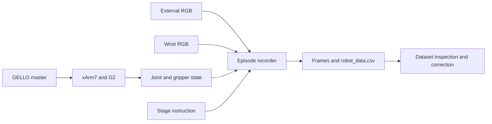
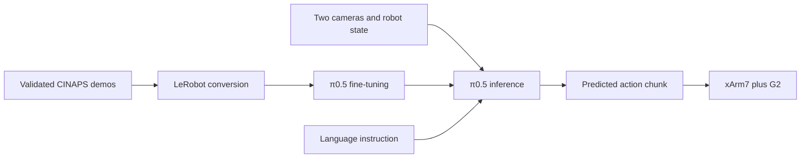
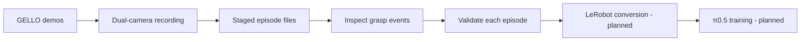

# π0.5 xArm7 CINAPS Letter Stacking

<p align="center"><b>GELLO teleoperation and staged CINAPS letter manipulation with UFactory xArm7 — towards π0.5 Vision-Language-Action learning</b></p>

<p align="center">
  
  
  
  
  
</p>

> **Project status:** GELLO teleoperation and data-collection tooling are documented. A corrected dataset directory with 50 episode folders (4.3 GB) has been located, and a 50-episode grasp-event report exists. These facts do **not** establish 50 successful placements, complete six-letter stacking, or trained π0.5 inference on CINAPS. Full episode-level validation and policy training remain future work.

---

## Overview

This repository documents a real-robot **CINAPS** letter-manipulation workflow using a **UFactory xArm7**, **UF G2 gripper**, **Dynamixel-based GELLO** teleoperator, and **external plus wrist RealSense cameras**. The staged task is to pick and place the letters **C, I, N, A, P, S** in their corresponding target positions.

The current work focuses on GELLO/xArm7 integration, joint-current tuning, image-and-robot-state demonstration recording, and dataset inspection. **π0.5 / OpenPI** fine-tuning and autonomous execution are planned extensions, not completed results for this task.

### Key Features

| Component | Details |
|---|---|
| Robot | UFactory xArm7, 7-DOF |
| Gripper | UFactory UF G2 |
| Teleoperation | GELLO / Dynamixel |
| Cameras | External and wrist Intel RealSense RGB |
| System | Ubuntu 24.04; ROS 2 Jazzy |
| Recorder sampling rate | 6 Hz in inspected staged recorder |
| Collection organization | 50 staged demonstrations |
| Located corrected dataset | `xarm_demos_cinaps_staged_50_corrected`, 4.3 GB locally |
| Planned training format | LeRobot |
| Planned VLA policy | π0.5 / OpenPI |

---

## System Architecture

### Recorded demonstration workflow



### Planned VLA workflow (not yet demonstrated for CINAPS)



---

## Real-Robot Setup

The hardware comprises xArm7, G2 gripper, a Dynamixel GELLO master, and two camera views. For the exact network/serial startup sequence, clutch behavior, safety checks, and previously observed controller errors, see [GELLO setup](docs/gello_setup.md).

Robot control scripts can command physical motion. Do not run multiple programs that own the robot or GELLO serial interface at the same time. Before testing, confirm emergency-stop access, clearance, joint mapping, robot readiness and gripper behavior.

---

## CINAPS Task Definition

The full objective is to arrange the scattered letters to spell **CINAPS** in order on the marked targets. The observed staged recorder uses this plan:

| Episode numbers | Stage | Demonstration instruction |
|---|---|---|
| 1–8 | C | Place C while all letters start scattered |
| 9–16 | I | Keep C fixed; place I |
| 17–24 | N | Keep C and I fixed; place N |
| 25–32 | A | Keep CIN fixed; place A |
| 33–40 | P | Keep CINA fixed; place P |
| 41–48 | S | Keep CINAP fixed; place S |
| 49–50 | FULL | Arrange C → I → N → A → P → S |

The sequence above describes the *collection design*, not a certified task-success count. The single-letter starting task is: **“Pick up the blue letter C and place it in the marked C position.”**

---

## Dataset and Workflow

The inspected local source script is `~/cinaps_collection/record_cinaps_staged_50.py`. It sets `FPS = 6.0`, reads external and wrist image topics, and records GELLO/xArm7 state into episode data. Its launcher is `run_record_cinaps_staged_50.sh`. These source files are **not yet included in this GitHub repository**, pending final code review, sanitization, and publication permission.

The local corrected dataset has **50 episode directories** and occupies **4.3 GB**. A separate report, *CINAPS 1–50 Grasp Report*, presents detected gripper-closing frames, camera images, joint data and G2 measurements. Gripper closure alone does not prove that an object was securely grasped or placed.



Further details: [Collection guide](docs/cinaps_collection.md) · [Grasp-report summary](docs/cinaps_grasp_report.md).

### Recording source files to review for publication

| Stage | Local source file | Repository status |
|---|---|---|
| Staged recording | `record_cinaps_staged_50.py` | Pending review/upload |
| Staged launcher | `run_record_cinaps_staged_50.sh` | Pending review/upload |
| General collection | `collect_cinaps_50.py` | Pending review/upload |
| General collection launcher | `run_cinaps_50.sh` | Pending review/upload |

---

## Repository Structure

```text
pi0.5-xArm7-cinaps-stacking/
├── gello_teleoperation/
│   ├── config/
│   │   └── xarm7_gello_local.yaml
│   ├── safe_gello_with_gripper.py
│   ├── test_gello_stiffness.py
│   └── README.md
├── docs/
│   ├── gello_setup.md
│   ├── gello_stiffness.md
│   ├── cinaps_collection.md
│   ├── cinaps_grasp_report.md
│   └── progress_checklist.md
├── .gitignore
└── README.md
```

**Planned additions:** `data_collection/`, `data_processing/`, `assets/`, `evaluation/`, `inference/`, and `tests/` as the corresponding actual scripts and experiments are reviewed.

---

## Installation and Environment

```bash
git clone https://github.com/KLochan/pi0.5-xArm7-cinaps-stacking.git
cd pi0.5-xArm7-cinaps-stacking

# Existing local environment used during development:
source ~/ufactory_teleop/.venv-gello/bin/activate
source /opt/ros/jazzy/setup.bash
source ~/xarm_ws/install/setup.bash
```

The GELLO driver and `ufactory_devices` modules originate from the developer's local upstream environment and are **not bundled** here. The committed YAML contains placeholders for machine-specific connection details. Refer to [GELLO setup](docs/gello_setup.md) for prerequisites; do not assume that cloning alone creates a runnable robot-control installation.

## Running the Project

The historically used startup command from the *original GELLO workspace* is:

```bash
cd ~/ufactory_teleop/gello_teleop
source ../.venv-gello/bin/activate
python safe_gello_with_gripper.py --config config/xarm7_gello_local.yaml
```

**Physical-motion warning:** Do not execute the command without supervised readiness/synchronization checks. A recorded controller error during one startup was resolved in a later session; no automatic error clearing is performed. The 20-degree tracking-lag parameter in the historical script is **diagnostic only**, not an enforced stop. Use hardware emergency stop if required; the software clutch is not an emergency stop.

The staged recording launcher also controls/coordinates data-collection activity and is **not a one-command safe startup recipe** until its remaining code and hardware effects are inspected.

---

## Evaluation and Grasp Report

A local **50-episode grasp-event analysis** exists for `xarm_demos_cinaps_staged_50_corrected`; it includes external and wrist views, seven joint values, gripper measurements and frames around the first detected gripper closing in each episode.

| Metric | Current evidence |
|---|---|
| Corrected episode folders | 50 |
| Corrected dataset size | 4.3 GB |
| Recording target rate | 6 Hz |
| Grasp-event analysis | Report produced |
| Verified successful placements | Not yet quantified |
| Verified full-sequence successes | Not yet quantified |
| CINAPS π0.5 inference latency | Not measured |

See [Grasp-report notes](docs/cinaps_grasp_report.md) and [Progress checklist](docs/progress_checklist.md). No handwash-task inference latency or success statistics are attributed to CINAPS.

---

## Repository Scope

This repository contains implementation code and technical notes for GELLO and xArm7 integration, plus documentation of staged CINAPS recording and evaluation. **Raw recordings, 4.3 GB dataset, private lab identifiers, checkpoints, ROS bags, and local caches are excluded.** Public reuse remains subject to permission from the relevant project/lab and third-party licenses.

## Roadmap

- [x] Establish GELLO-to-xArm7 teleoperation and basic controller diagnostics
- [x] Document Dynamixel current/stiffness experimentation
- [x] Record and locate a 50-episode staged dataset
- [x] Produce a 50-episode grasp-event inspection report
- [x] Publish GELLO setup, collection and evaluation documentation
- [ ] Review and publish staged recorder and launch scripts
- [ ] Audit all 50 corrected episodes and label valid grasp/place outcomes
- [ ] Add approved task images and representative demo GIF
- [ ] Add dataset preprocessing and LeRobot conversion
- [ ] Fine-tune and evaluate π0.5 for CINAPS
- [ ] Report controlled multi-trial letter-placement and full-sequence success rates

---

## Acknowledgements

Work performed at **CINAPS Lab, Graduate School of System Informatics, Kobe University, Japan**.

Built with or intended to integrate **GELLO**, **UFactory xArm7 / G2**, **ROS 2**, **Intel RealSense**, **LeRobot** and **π0.5 / OpenPI**. Upstream packages and devices retain their respective licenses and usage terms.
